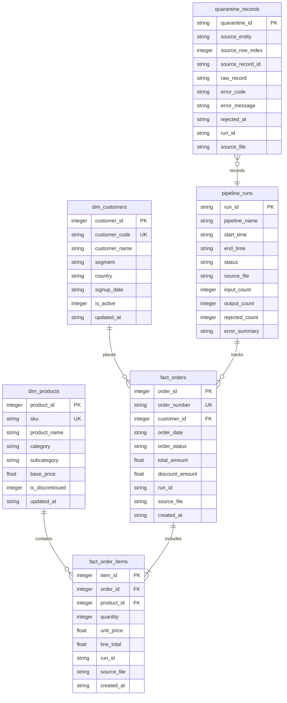

# Analytical Workload Optimization: Data Dictionary

## 1. Overview
This document specifies the logical and physical data schemas for the analytical workload pipeline, spanning source inputs, target dimensional model, metadata tracking, and the quarantine dead-letter repository.

---

## 2. Dimensional Model Architecture (Star Schema)

---

## 3. Entity Specifications

### 3.1 `dim_customers` (Customer Dimension)
- **Grain:** One row per customer.
- **Description:** Conformed customer dimension capturing segmentation and status.

| Column | Data Type | Nullable | Primary Key | Foreign Key | Description / Validation Rule |
|:---|:---|:---:|:---:|:---:|:---|
| `customer_id` | `INTEGER` | No | Yes | No | Deterministic unique integer identifier. |
| `customer_code` | `TEXT` | No | No | No | Unique natural business identifier (e.g. `CUST-000001`). |
| `customer_name` | `TEXT` | No | No | No | Customer or enterprise company name. |
| `segment` | `TEXT` | No | No | No | Customer cohort (`ENTERPRISE`, `SMB`, `CONSUMER`, `GOVERNMENT`). |
| `country` | `TEXT` | No | No | No | 2-character ISO country code. |
| `signup_date` | `TEXT` | No | No | No | ISO-8601 calendar date (`YYYY-MM-DD`). |
| `is_active` | `INTEGER` | No | No | No | `1` = Active, `0` = Inactive. |
| `updated_at` | `TEXT` | No | No | No | ISO-8601 timestamp of last metadata modification. |

---

### 3.2 `dim_products` (Product Dimension)
- **Grain:** One row per product SKU.
- **Description:** Catalog dimension detailing category hierarchy and pricing.

| Column | Data Type | Nullable | Primary Key | Foreign Key | Description / Validation Rule |
|:---|:---|:---:|:---:|:---:|:---|
| `product_id` | `INTEGER` | No | Yes | No | Deterministic unique integer identifier. |
| `sku` | `TEXT` | No | No | No | Stock keeping unit (e.g. `SKU-ELE-00001`). |
| `product_name` | `TEXT` | No | No | No | Product display title. |
| `category` | `TEXT` | No | No | No | Top-level category (`Electronics`, `Appliances`, `Furniture`, `Apparel`, `Books`). |
| `subcategory` | `TEXT` | No | No | No | Sub-classification within parent category. |
| `base_price` | `REAL` | No | No | No | Retail baseline price (`> 0.00`). |
| `is_discontinued` | `INTEGER` | No | No | No | `1` = Discontinued, `0` = Active catalog item. |
| `updated_at` | `TEXT` | No | No | No | ISO-8601 timestamp of last metadata modification. |

---

### 3.3 `fact_orders` (Order Header Fact)
- **Grain:** One row per customer order transaction.
- **Description:** Core fact table tracking transaction timestamps, status, totals, and run lineage.

| Column | Data Type | Nullable | Primary Key | Foreign Key | Description / Validation Rule |
|:---|:---|:---:|:---:|:---:|:---|
| `order_id` | `INTEGER` | No | Yes | No | Deterministic unique order identifier. |
| `order_number` | `TEXT` | No | No | No | Business order number (e.g. `ORD-2025-0000001`). |
| `customer_id` | `INTEGER` | No | No | `dim_customers.customer_id` | Must exist in `dim_customers`. Orphan records are quarantined. |
| `order_date` | `TEXT` | No | No | No | ISO-8601 calendar date (`YYYY-MM-DD`). Validated format. |
| `order_status` | `TEXT` | No | No | No | Valid status: `COMPLETED`, `PENDING`, `CANCELLED`, `RETURNED`, `SHIPPED`. |
| `total_amount` | `REAL` | No | No | No | Header gross order amount (`>= 0.00`). |
| `discount_amount`| `REAL` | No | No | No | Promotional or voucher discount applied (`>= 0.00`). |
| `run_id` | `TEXT` | No | No | `pipeline_runs.run_id` | Lineage trace identifying ingestion batch run. |
| `source_file` | `TEXT` | No | No | No | Source filename batch lineage. |
| `created_at` | `TEXT` | No | No | No | Target database commit timestamp (ISO-8601 UTC). |

---

### 3.4 `fact_order_items` (Order Line Fact)
- **Grain:** One row per individual item line within an order.
- **Description:** Granular fact table storing product quantity, unit price, and extended line total.

| Column | Data Type | Nullable | Primary Key | Foreign Key | Description / Validation Rule |
|:---|:---|:---:|:---:|:---:|:---|
| `item_id` | `INTEGER` | No | Yes | No | Deterministic unique line item identifier. |
| `order_id` | `INTEGER` | No | No | `fact_orders.order_id` | Must reference a valid non-quarantined order in current or past batch. |
| `product_id` | `INTEGER` | No | No | `dim_products.product_id` | Must exist in `dim_products`. Orphan records are quarantined. |
| `quantity` | `INTEGER` | No | No | No | Units purchased (`> 0`). |
| `unit_price` | `REAL` | No | No | No | Price charged per unit (`> 0.00`). |
| `line_total` | `REAL` | No | No | No | Calculated line total: `abs(line_total - (quantity * unit_price)) <= 0.05`. |
| `run_id` | `TEXT` | No | No | `pipeline_runs.run_id` | Lineage trace identifying ingestion batch run. |
| `source_file` | `TEXT` | No | No | No | Source filename batch lineage. |
| `created_at` | `TEXT` | No | No | No | Target database commit timestamp (ISO-8601 UTC). |

---

### 3.5 `quarantine_records` (Dead-Letter Quarantine)
- **Grain:** One row per failed/rejected record.
- **Description:** Traceable dead-letter queue preserving the raw unparsed payload and precise error diagnostic.

| Column | Data Type | Nullable | Primary Key | Foreign Key | Description / Validation Rule |
|:---|:---|:---:|:---:|:---:|:---|
| `quarantine_id` | `TEXT` | No | Yes | No | Deterministic composite key (`source_file:entity:row_index`) preventing duplicate entries on reruns. |
| `source_entity` | `TEXT` | No | No | No | Target entity attempted (`fact_orders` or `fact_order_items`). |
| `source_row_index`| `INTEGER` | No | No | No | 0-based source record index in input file. |
| `source_record_id`| `TEXT` | Yes | No | No | Natural source identifier (`order_id` or `item_id`) if present. |
| `raw_record` | `TEXT` | No | No | No | Exact JSON serialized raw input row. |
| `error_code` | `TEXT` | No | No | No | Standardized error category (e.g. `ERR_ORPHAN_CUSTOMER_ID`). |
| `error_message` | `TEXT` | No | No | No | Detailed validation message or exception stack. |
| `rejected_at` | `TEXT` | No | No | No | ISO-8601 UTC timestamp of rejection. |
| `run_id` | `TEXT` | No | No | `pipeline_runs.run_id` | Lineage trace to the batch run that encountered this record. |
| `source_file` | `TEXT` | No | No | No | Source file from which the invalid row originated. |

---

### 3.6 `pipeline_runs` (Pipeline Operational Metadata)
- **Grain:** One row per pipeline execution run.
- **Description:** Observability log tracking start time, duration, status, and reconciliation metrics.

| Column | Data Type | Nullable | Primary Key | Foreign Key | Description / Validation Rule |
|:---|:---|:---:|:---:|:---:|:---|
| `run_id` | `TEXT` | No | Yes | No | Unique execution run identifier (e.g. `run_20261104_093900_a1b2c3`). |
| `pipeline_name` | `TEXT` | No | No | No | Name of pipeline workflow (`retail_analytics_ingest`). |
| `start_time` | `TEXT` | No | No | No | ISO-8601 execution start timestamp. |
| `end_time` | `TEXT` | Yes | No | No | ISO-8601 execution completion timestamp. |
| `status` | `TEXT` | No | No | No | State machine: `RUNNING`, `SUCCESS`, `PARTIAL_SUCCESS`, `FAILED`. |
| `source_file` | `TEXT` | Yes | No | No | Source input files processed by this run. |
| `input_count` | `INTEGER` | No | No | No | Total records read from source files. |
| `output_count` | `INTEGER` | No | No | No | Total valid records committed to target tables. |
| `rejected_count`| `INTEGER` | No | No | No | Total records routed to quarantine. |
| `error_summary` | `TEXT` | Yes | No | No | Summary explanation of rejections or failures. |
