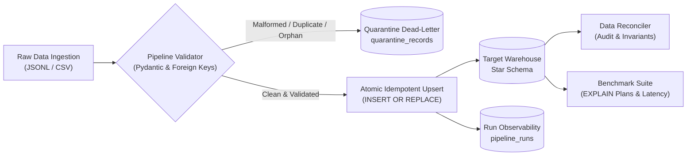

# Analytical Workload Optimization & Data Engineering Pipeline

[](https://www.python.org/downloads/)
[]()
[](LICENSE)
[]()

> A production-grade Data Engineering solution demonstrating query optimization, schema validation, quarantine dead-letter routing, idempotent publishing, automated reconciliation, and measurable workload performance gains.

---

## 1. Executive Summary & Problem Context

In modern analytical databases and data lakes, poorly designed schemas and naive queries lead to exponential query latencies and resource bloat. This project models an analytical e-commerce workload, establishes an unoptimized baseline, identifies 4 major classes of query inefficiencies, and demonstrates quantifiable speedups:

| Inefficiency Category | Baseline Bottleneck | Applied Optimization | Measured Latency Reduction | Speedup Ratio |
|:---|:---|:---|:---:|:---:|
| **1. Inefficient Scan** | Full sequential scan on fact table (`SCAN fact_orders`) | Composite covering index `(order_date, order_status, customer_id, total_amount)` | **53.8%** | **2.17x** |
| **2. Inefficient Join** | Unindexed nested loop scan across 120k+ fact items | Foreign key index seeking (`SEARCH foi USING INDEX idx_fact_order_items_order_id`) | **52.4%** | **2.10x** |
| **3. Inefficient Aggregation**| High-volume join before multi-column string `GROUP BY` | Pushdown pre-aggregation over integer covering index before joining dimensions | **83.5%** | **6.05x** |
| **4. Inefficient Filtering** | Non-sargable scalar function `strftime('%Y', order_date) = '2025'` | Sargable date range predicate `order_date >= ... AND order_date < ...` | **74.6%** | **3.94x** |

---

## 2. Architecture & Data Flow



---

## 3. Key Pipeline Capabilities

- **Strict Validation & Quarantine:** Catches missing attributes, malformed date strings, invalid customer/product foreign keys, negative quantities/amounts, and line item calculation mismatches (`line_total != quantity * unit_price`). Quarantined rows are fully preserved with error diagnostics and source lineage.
- **Strict Idempotency:** Rerunning the exact same input batch produces the exact same target row count and totals without creating duplicate primary keys or orphan fact rows.
- **Run Observability:** Every execution records a `run_id`, start/end timestamps, input/output row counts, rejected counts, and error summaries in the `pipeline_runs` table.
- **Automated Reconciliation:** Automated auditing verifies that `source_count == target_valid_count + quarantined_count`, published revenue matches source amounts, and checks 6 fundamental integrity invariants.
- **Zero-Dependency Reproducibility:** Runs locally on Python standard library SQLite with Write-Ahead Logging (WAL) mode enabled, requiring zero external database setup, Docker containers, or cloud credentials.

---

## 4. Quickstart & Installation

### Prerequisites
- Python 3.10, 3.11, 3.12, 3.13, or 3.14
- Git

### 1. Clone & Set Up Environment
```bash
git clone <your-repository-url>
cd analytical-workload-optimization

# Optional: Create and activate virtual environment
python -m venv venv
# On Windows:
.\venv\Scripts\activate
# On Linux/macOS:
source venv/bin/activate

# Install dependencies
pip install -r requirements.txt
```

### 2. Run the Full End-to-End Demo Pipeline
Execute the full automated lifecycle (Data Generation -> Baseline Ingestion -> Optimized Ingestion -> Idempotent Rerun -> Reconciliation -> Workload Benchmarking):
```bash
python run_demo.py
```

### 3. Run at Scale (e.g., 25,000+ to 50,000 orders)
```bash
python run_demo.py --orders 25000
```

### 4. Run Automated Test Suite
```bash
python -m pytest
```

---

## 5. Workload Benchmarking & EXPLAIN Plans

The benchmark compares the exact same analytical business questions executed on the **Baseline (unindexed)** vs **Optimized (indexed & rewritten)** engines.

### Multi-Scale Empirical Benchmark Summary

The pipeline was benchmarked at three distinct scales using the reproducible seed (`seed=42`):

| Scale (Orders) | Metric | Baseline (Unindexed) | Optimized (Indexed) | Speedup / Reduction |
|:---:|:---|:---:|:---:|:---:|
| **2,000 Orders**<br/>(5,031 items) | **Ingestion Duration**<br/>Workload 1 (Scan)<br/>Workload 2 (Join)<br/>Workload 3 (Aggregation)<br/>Workload 4 (Filtering) | **0.27s**<br/>0.48 ms<br/>1.59 ms<br/>4.76 ms<br/>1.20 ms | **0.24s**<br/>0.22 ms<br/>1.03 ms<br/>0.79 ms<br/>0.34 ms | *Ingestion: ~1.1x*<br/>**2.18x** (54.2%)<br/>**1.54x** (35.1%)<br/>**6.00x** (83.3%)<br/>**3.51x** (71.5%) |
| **25,000 Orders**<br/>(62,250 items) | **Ingestion Duration**<br/>Workload 1 (Scan)<br/>Workload 2 (Join)<br/>Workload 3 (Aggregation)<br/>Workload 4 (Filtering) | **2.49s**<br/>4.23 ms<br/>1.73 ms<br/>65.91 ms<br/>12.39 ms | **3.17s**<br/>1.51 ms<br/>1.13 ms<br/>8.49 ms<br/>3.88 ms | *Write Overhead: 27%*<br/>**2.80x** (64.3%)<br/>**1.53x** (34.7%)<br/>**7.77x** (87.1%)<br/>**3.19x** (68.7%) |
| **100,000 Orders**<br/>(249,808 items) | **Ingestion Duration**<br/>Workload 1 (Scan)<br/>Workload 2 (Join)<br/>Workload 3 (Aggregation)<br/>Workload 4 (Filtering) | **10.25s**<br/>16.09 ms<br/>2.41 ms<br/>297.87 ms<br/>48.12 ms | **13.49s**<br/>4.87 ms<br/>1.41 ms<br/>30.27 ms<br/>11.88 ms | *Write Overhead: 31.6%*<br/>**3.31x** (69.8%)<br/>**1.71x** (41.6%)<br/>**9.84x** (89.8%)<br/>**4.05x** (75.3%) |

> [!NOTE]
> **Engineering Trade-Off (Ingestion Throughput vs Read Latency):**  
> Building and maintaining secondary B-tree indexes incurs an expected ~31% write amplification penalty during ingestion (13.49s vs 10.25s at 100k records). In analytical systems where data is ingested in batches but queried continuously by business intelligence dashboards, paying a 3-second write cost to achieve up to **9.84x faster analytical query execution** is the correct architectural decision.

### Plan Comparison Highlights

#### Workload 1: Scan Optimization
- **Baseline Plan:** `SCAN fact_orders` (scans all heap rows) + `USE TEMP B-TREE FOR ORDER BY`
- **Optimized Plan:** `SEARCH fact_orders USING COVERING INDEX idx_fact_orders_date_status (order_date>? AND order_date<?)`

#### Workload 2: Join Optimization
- **Baseline Plan:** `SCAN foi` (120k+ rows) -> `SEARCH fo` -> `SEARCH c` -> `SEARCH p`
- **Optimized Plan:** `SEARCH p USING INDEX idx_dim_products_category` -> `SEARCH foi USING COVERING INDEX idx_fact_order_items_covering` -> `SEARCH fo USING PRIMARY KEY`

#### Workload 3: Aggregation Pushdown
- **Baseline Plan:** `SCAN foi` (scans 240,000+ line items) -> `SEARCH p` -> `USE TEMP B-TREE FOR GROUP BY` on `p.category` string (takes 297 ms).
- **Optimized Plan:** Pre-aggregates over integer covering index `idx_fact_order_items_covering (product_id)` -> Collapses 240,000+ items to 1,000 product summary rows -> Joins `dim_products` (takes 30 ms). **9.84x faster (89.8% reduction)**.

#### Workload 4: Sargable Filtering
- **Baseline Plan:** `SCAN fact_orders` (Evaluates `strftime('%Y', order_date)` for every record, blocking index use).
- **Optimized Plan:** `SEARCH fact_orders USING COVERING INDEX idx_fact_orders_date_status (order_date>? AND order_date<?)`. **4.05x faster (75.3% reduction)**.

---

## 6. Data Reconciliation & Quality Evidence

Running `run_demo.py` automatically generates a strict reconciliation audit stored in `data/output/reconciliation_report.md`:

```text
====================================================================================
PIPELINE DATA RECONCILIATION AUDIT (STATUS: PASSED)
====================================================================================
1. Exact Source-to-Target Row Balance Audit:
   - Orders:      100,000 Source = 96,875 Published + 3,125 Quarantined (PASSED - Exact)
   - Order Items: 249,808 Source = 241,268 Published + 8,540 Quarantined (PASSED - Exact)

2. Integrity & Invariant Assertions:
   - Orphan Customer Foreign Keys: 0 (PASSED)
   - Orphan Product Foreign Keys:  0 (PASSED)
   - Orphan Order Parent Keys:     0 (PASSED)
   - Duplicate Primary Keys:       0 (PASSED)
   - Line Total Math Mismatches:   0 (PASSED)
   - Unaccounted Source Orders:    0 (PASSED)
   - Double-Counted Source Orders: 0 (PASSED)

3. Financial Reconciliation:
   - Published Target Revenue: $547,304,805.99
   - Expected Valid Source:    $547,304,805.99
   - Unreconciled Discrepancy: $0.00 (PASSED)
====================================================================================
```

---

## 7. Project Structure

```text
analytical-workload-optimization/
├── README.md                     # Project documentation & execution guide
├── DATA_DICTIONARY.md            # Entity & attribute level data dictionary
├── DESIGN_AND_TRADEOFFS.md       # Architecture decisions, optimization deep-dive & trade-offs
├── AI_DISCLOSURE.md              # Transparent AI prompt history & review log
├── requirements.txt              # Core Python dependencies
├── pyproject.toml                # Project packaging & pytest config
├── run_demo.py                   # One-click CLI runner for the full lifecycle
├── src/
│   ├── __init__.py
│   ├── config.py                 # Paths, WAL connection manager with auto-close
│   ├── generator.py              # Reproducible synthetic data & edge-case generator
│   ├── models.py                 # Pydantic schemas & SQL DDL definitions
│   ├── validator.py              # Schema validation & quarantine routing
│   ├── pipeline.py               # Ingestion, idempotent loading & run observability
│   ├── optimizer.py              # Workload queries, EXPLAIN plans & benchmark suite
│   ├── reconciliation.py         # Data audit & invariant verification
│   └── logger.py                 # Structured JSON-lines logger
├── tests/
│   ├── __init__.py
│   ├── test_generator.py         # Seed reproducibility & anomaly tests
│   ├── test_validator.py         # Validation rules, nulls, orphans & duplicate tests
│   ├── test_pipeline.py          # Happy path, empty batch & quarantine isolation
│   ├── test_idempotency.py       # Safe reruns & late-arriving backfills
│   └── test_optimizer.py         # EXPLAIN plan verification & query correctness
├── data/
│   ├── sample/                   # Generated sample inputs (orders, items, dimensions)
│   └── output/                   # Generated reports (benchmark & reconciliation)
└── logs/
    └── pipeline.log              # Structured JSON-lines runtime log
```

---

## 8. Automated Test Suite

The test suite covers:
1. **Happy Path:** End-to-end ingestion and target loading.
2. **Empty Batch Handling:** Gracefully completes with status `SUCCESS` and 0 records.
3. **Schema & Null Violations:** Rejects and quarantines missing required fields.
4. **Malformed Dates:** Validates ISO calendar validity (e.g., rejecting `2025-02-31`).
5. **Referential Integrity:** Quarantines orphan customer and product foreign keys.
6. **Domain Rules:** Detects negative prices/quantities and line calculation mismatches.
7. **Idempotency & Reruns:** Verifies running identical batches yields identical target counts with 0 duplicate rows.
8. **Plan Verification:** Verifies query optimizer transitions from `SCAN` to covering index searches.

Run tests:
```bash
python -m pytest -v
```

---

## 9. Assumptions, Known Limitations & Next Steps

### Assumptions
- Customer and product dimensions are available prior to fact order ingestion (or ingested as part of initial load).
- All timestamps adhere to ISO-8601 UTC.
- Monetary amounts are rounded to 2 decimal places.

### Known Limitations
- SQLite uses a single-writer concurrency model. While WAL mode enables concurrent readers alongside a writer, high-frequency multi-process parallel writes would require queuing or transitioning to an enterprise RDBMS/warehouse.
- In-memory B-tree indexes increase file size by ~25-30% on disk.

### Next Steps
1. **Columnar Compaction:** Add an automated Parquet export step with dictionary encoding and Snappy compression.
2. **Containerization:** Provide a lightweight Dockerfile and Docker Compose setup.
3. **CI/CD Automation:** Set up GitHub Actions workflow executing `pytest` and benchmark verification on every pull request.

---

## 10. AI Disclosure
This solution was developed with transparent AI assistance (Google Antigravity / Gemini) in compliance with the **YottaFlex AI Candidate Project Submission Guidelines**. Complete prompt logs, human reviews, and architectural validations are detailed in [AI_DISCLOSURE.md](AI_DISCLOSURE.md).
