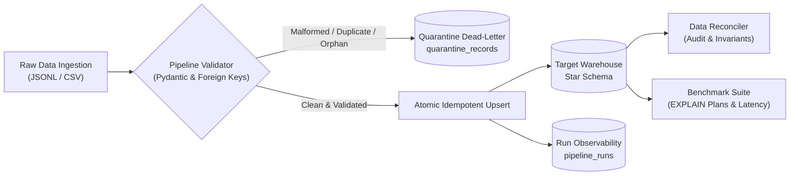

# Analytical Workload Optimization & Data Engineering Pipeline

[](https://www.python.org/downloads/)
[]()
[](LICENSE)
[]()

> An end-to-end Data Engineering project demonstrating analytical query optimization, schema validation, quarantine handling, idempotent ingestion, automated reconciliation, and measurable workload performance improvements.

---

## 1. Executive Summary & Problem Context

In analytical databases and data warehouses, inefficient schemas, unoptimized queries, and unnecessary data scans can increase query latency and resource consumption.

This project models an analytical e-commerce workload. It establishes an unoptimized query baseline, identifies four major classes of query inefficiencies, and applies indexing and query-rewriting techniques to improve analytical performance.

The project evaluates:

- Scan optimization
- Join optimization
- Aggregation pushdown
- Sargable filtering

The multi-scale benchmark results are presented in Section 5. At the 100,000-order scale, the recorded benchmark shows improvements across all four workloads.

| Inefficiency Category | Baseline Bottleneck | Applied Optimization |
|:---|:---|:---|
| **1. Inefficient Scan** | Full sequential scan on the fact table | Composite covering index |
| **2. Inefficient Join** | Unindexed nested-loop access across fact items | Foreign-key and covering indexes |
| **3. Inefficient Aggregation** | High-volume join before aggregation | Pre-aggregation before dimension joins |
| **4. Inefficient Filtering** | Non-sargable date function | Indexed date-range predicate |

---

## 2. Architecture & Data Flow



### Pipeline flow

1. Generate reproducible synthetic customer, product, order, and order-item data.
2. Ingest CSV and JSONL input files.
3. Validate schemas, required fields, data types, and relationships.
4. Route invalid records to quarantine with error details.
5. Load valid records into the target warehouse.
6. Record execution metrics and pipeline status.
7. Run reconciliation checks.
8. Compare baseline and optimized analytical queries.

---

## 3. Key Pipeline Capabilities

- **Schema Validation:** Validates required attributes, data types, date formats, and domain rules using Pydantic-based validation.
- **Quarantine Handling:** Routes malformed records, duplicate keys, orphan references, and invalid business values into quarantine with error diagnostics and source lineage.
- **Idempotent Ingestion:** Supports safe reruns of the same input batch without creating duplicate primary keys or changing the expected published totals.
- **Run Observability:** Records run identifiers, timestamps, input and output counts, rejected records, and execution status in the `pipeline_runs` table.
- **Automated Reconciliation:** Checks source-to-target row accounting, foreign-key integrity, duplicate keys, line-total calculations, and revenue consistency.
- **Reproducible Data Generation:** Uses a fixed random seed to generate repeatable synthetic datasets.
- **Analytical Optimization:** Compares baseline and optimized query execution plans and latency.
- **Local Reproducibility:** Runs locally using SQLite without requiring an external database server, Docker containers, or cloud credentials. Install the Python dependencies listed in `requirements.txt` before running the project.

---

## 4. Quickstart & Installation

### Prerequisites

- Python 3.10 or later
- Git
- pip

### 1. Clone the repository

```bash
git clone https://github.com/Bheemalingappa/analytical-workload-optimization.git
cd analytical-workload-optimization
```

### 2. Create and activate a virtual environment

```bash
python -m venv venv
```

**Windows PowerShell:**

```powershell
.\venv\Scripts\Activate.ps1
```

**Linux/macOS:**

```bash
source venv/bin/activate
```

### 3. Install dependencies

```bash
python -m pip install --upgrade pip
pip install -r requirements.txt
```

### 4. Run the full end-to-end demo pipeline

The demo executes the project lifecycle, including data generation, ingestion, idempotent reruns, reconciliation, and workload benchmarking.

```bash
python run_demo.py
```

### 5. Run at scale

For example, generate and process 25,000 orders:

```bash
python run_demo.py --orders 25000
```

### 6. Run the automated test suite

```bash
python -m pytest -v
```

---

## 5. Workload Benchmarking & EXPLAIN Plans

The benchmark compares analytical business queries executed against a baseline database and an optimized database.

The optimized workload uses indexes and rewritten queries to reduce unnecessary scans and improve data access.

### Multi-Scale Empirical Benchmark Summary

The pipeline was benchmarked at three scales using the reproducible seed `seed=42`.

| Scale | Metric | Baseline | Optimized | Speedup / Reduction |
|:---:|:---|:---:|:---:|:---:|
| **2,000 Orders**<br/>(5,031 items) | Ingestion Duration | 0.27s | 0.24s | ~1.1x |
| | Workload 1: Scan | 0.48 ms | 0.22 ms | **2.18x (54.2%)** |
| | Workload 2: Join | 1.59 ms | 1.03 ms | **1.54x (35.1%)** |
| | Workload 3: Aggregation | 4.76 ms | 0.79 ms | **6.00x (83.3%)** |
| | Workload 4: Filtering | 1.20 ms | 0.34 ms | **3.51x (71.5%)** |
| **25,000 Orders**<br/>(62,250 items) | Ingestion Duration | 2.49s | 3.17s | Write overhead: ~27% |
| | Workload 1: Scan | 4.23 ms | 1.51 ms | **2.80x (64.3%)** |
| | Workload 2: Join | 1.73 ms | 1.13 ms | **1.53x (34.7%)** |
| | Workload 3: Aggregation | 65.91 ms | 8.49 ms | **7.77x (87.1%)** |
| | Workload 4: Filtering | 12.39 ms | 3.88 ms | **3.19x (68.7%)** |
| **100,000 Orders**<br/>(249,808 items) | Ingestion Duration | 10.25s | 13.49s | Write overhead: ~31.6% |
| | Workload 1: Scan | 14.35 ms | 4.42 ms | **3.24x (69.2%)** |
| | Workload 2: Join | 2.30 ms | 0.87 ms | **2.63x (61.9%)** |
| | Workload 3: Aggregation | 272.62 ms | 29.88 ms | **9.12x (89.0%)** |
| | Workload 4: Filtering | 46.77 ms | 12.18 ms | **3.84x (74.0%)** |

> **Engineering Trade-off - Ingestion Throughput vs. Read Latency**
>
> Creating and maintaining secondary indexes adds write overhead during ingestion. In the 100,000-order benchmark, optimized ingestion took 13.49 seconds compared with 10.25 seconds for the baseline.
>
> This illustrates a common analytical engineering trade-off: additional ingestion cost can be worthwhile when analytical queries are executed frequently. The recorded benchmark shows up to 9.12x faster execution for the aggregation workload.

### Benchmark Methodology

- **Dataset:** Synthetic e-commerce data generated with the fixed seed `42`.
- **Scales:** 2,000, 25,000, and 100,000 orders.
- **Database:** SQLite.
- **Comparison:** Baseline and optimized database/query workloads.
- **Execution plans:** SQLite `EXPLAIN QUERY PLAN` is used to inspect table scans and index access.
- **Measurements:** Query execution latency and ingestion duration are recorded in the benchmark output.
- **Reproducibility:** Run the demo pipeline to generate benchmark results locally.

Benchmark timings are environment-dependent. They should be interpreted as measurements from the recorded project runs, not universal performance guarantees.

### Plan Comparison Highlights

#### Workload 1: Scan Optimization

- **Baseline Plan:** `SCAN fact_orders`
- **Optimized Plan:** `SEARCH fact_orders USING COVERING INDEX idx_fact_orders_date_status`

The optimized query uses a composite index to reduce unnecessary table scanning.

#### Workload 2: Join Optimization

- **Baseline Plan:** `SCAN foi` followed by searches across related tables.
- **Optimized Plan:** Uses the product category index, covering item index, and order primary key.

The indexes improve access to related records during joins.

#### Workload 3: Aggregation Pushdown

- **Baseline Plan:** Scans a large number of order-item rows and performs grouping after joining dimensions.
- **Optimized Plan:** Pre-aggregates using an integer covering index before joining the product dimension.

This reduces the number of rows involved in the final aggregation.

#### Workload 4: Sargable Filtering

**Baseline Predicate:**

```sql
strftime('%Y', order_date) = '2025'
```

**Optimized Predicate:**

```sql
order_date >= '2025-01-01'
AND order_date < '2026-01-01'
```

The date-range predicate allows the database to use the date index instead of applying a function to every row.

---

## 6. Data Reconciliation & Quality Evidence

Running `run_demo.py` generates a reconciliation report at:

`data/output/reconciliation_report.md`

The recorded 100,000-order reconciliation results are:

```text
====================================================================================
PIPELINE DATA RECONCILIATION AUDIT (STATUS: PASSED)
====================================================================================

1. Exact Source-to-Target Row Balance Audit:

   Orders:
   100,000 Source = 96,875 Published + 3,125 Quarantined

   Order Items:
   249,808 Source = 241,268 Published + 8,540 Quarantined

2. Integrity & Invariant Assertions:

   Orphan Customer Foreign Keys: 0
   Orphan Product Foreign Keys:  0
   Orphan Order Parent Keys:     0
   Duplicate Primary Keys:       0
   Line Total Math Mismatches:   0
   Unaccounted Source Orders:    0
   Double-Counted Source Orders: 0

3. Financial Reconciliation:

   Published Target Revenue: $547,304,805.99
   Expected Valid Source:    $547,304,805.99
   Unreconciled Discrepancy: $0.00

====================================================================================
```

These results demonstrate exact row accounting and matching published revenue for the recorded run.

### Quarantine Diagnostics

**Orders**

| Error Code | Rejected Record Count |
|:---|---:|
| `ERR_DUPLICATE_ORDER_KEY` | 642 |
| `ERR_MALFORMED_ORDER_SCHEMA` | 1,876 |
| `ERR_ORPHAN_CUSTOMER_ID` | 607 |
| **Total** | **3,125** |

**Order Items**

| Error Code | Rejected Record Count |
|:---|---:|
| `ERR_MALFORMED_ITEM_SCHEMA` | 1,257 |
| `ERR_ORPHAN_ORDER_ID` | 6,088 |
| `ERR_ORPHAN_PRODUCT_ID` | 1,195 |
| **Total** | **8,540** |

---

## 7. Project Structure

```text
analytical-workload-optimization/
|
+-- README.md
+-- AI_DISCLOSURE.md
+-- DATA_DICTIONARY.md
+-- DESIGN_AND_TRADEOFFS.md
+-- LICENSE
+-- PROMPT_HISTORY.md
+-- requirements.txt
+-- pyproject.toml
+-- run_demo.py
|
+-- src/
|   +-- __init__.py
|   +-- config.py
|   +-- generator.py
|   +-- logger.py
|   +-- models.py
|   +-- optimizer.py
|   +-- pipeline.py
|   +-- reconciliation.py
|   +-- validator.py
|
+-- tests/
|   +-- __init__.py
|   +-- test_generator.py
|   +-- test_idempotency.py
|   +-- test_optimizer.py
|   +-- test_pipeline.py
|   +-- test_reconciliation.py
|   +-- test_validator.py
|
+-- data/
    +-- sample/
    |   +-- Generated sample input datasets
    |
    +-- output/
        +-- benchmark_report.md
        +-- reconciliation_report.md
```

Runtime logs are generated locally and are not required to be committed to the repository.

---

## 8. Automated Test Suite

The automated test suite contains 24 tests covering the main pipeline and data-quality scenarios.

Test coverage includes:

1. **Happy Path:** End-to-end ingestion and target loading.
2. **Empty Batch Handling:** Handles empty input batches.
3. **Schema Validation:** Detects missing required fields and invalid values.
4. **Malformed Dates:** Rejects invalid calendar dates.
5. **Referential Integrity:** Detects orphan customer and product references.
6. **Duplicate Detection:** Detects duplicate primary keys.
7. **Domain Rules:** Detects invalid quantities, amounts, and line-total calculations.
8. **Idempotency:** Verifies safe reruns without duplicate records.
9. **Backfill Handling:** Tests late-arriving data.
10. **Quarantine Isolation:** Verifies rejected records are separated from valid records.
11. **Reconciliation:** Checks source-to-target accounting and revenue consistency.
12. **Query Plan Verification:** Checks that optimized queries use expected indexes.

Run the tests:

```bash
python -m pytest -v
```

Latest verification:

```text
24 passed in 2.39s
```

---

## 9. Assumptions, Known Limitations & Next Steps

### Assumptions

- Customer and product dimensions are available before fact-order ingestion or are included in the initial load.
- Date values follow the expected ISO date format.
- Monetary amounts are rounded to two decimal places.
- Synthetic data is used for repeatable testing and benchmarking.

### Known Limitations

- SQLite uses a single-writer concurrency model. WAL mode allows readers to operate alongside a writer, but high-frequency parallel writes may require queuing or migration to an enterprise database.
- Indexes increase storage requirements and add write overhead. The actual impact depends on the dataset, schema, and index definitions.
- Benchmark timings are environment-dependent and may vary across machines and repeated runs.
- Synthetic data does not represent every production data distribution or workload pattern.
- The recorded benchmark timings do not establish performance guarantees for other database engines or production environments.

### Next Steps

1. **Columnar Storage:** Add Parquet export with dictionary encoding and compression.
2. **Containerization:** Add Docker and Docker Compose support.
3. **CI/CD:** Add GitHub Actions to run automated tests on each pull request.
4. **Scalable Processing:** Evaluate distributed processing for larger datasets.
5. **Monitoring:** Extend pipeline metrics and operational monitoring.

---

## 10. AI Disclosure

This project was developed with AI assistance using ChatGPT (OpenAI) and Google Antigravity.

AI assistance supported parts of the development process, including implementation guidance, debugging, testing, and documentation. The candidate reviewed, tested, and validated the resulting project and is responsible for understanding its implementation, design decisions, dependencies, and limitations.

See the following files for further information:

- [AI_DISCLOSURE.md](AI_DISCLOSURE.md) - AI usage and human review.
- [PROMPT_HISTORY.md](PROMPT_HISTORY.md) - Available AI prompt history and documented limitations.

Historical prompt coverage is not represented as complete where exact prompt records have not been retrieved. The prompt-history document distinguishes available exact prompts from topic summaries and outstanding retrieval limitations.
